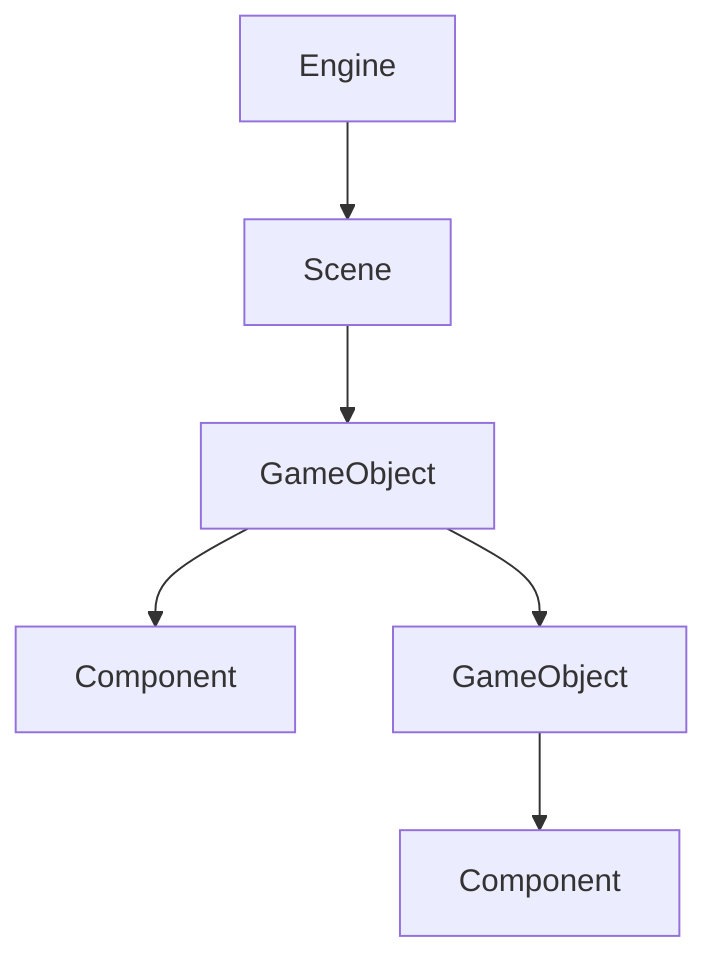
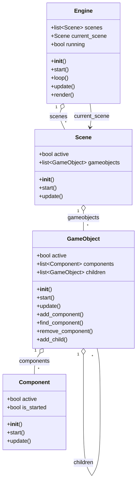
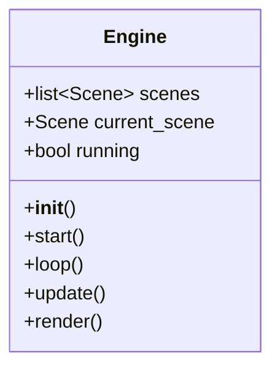
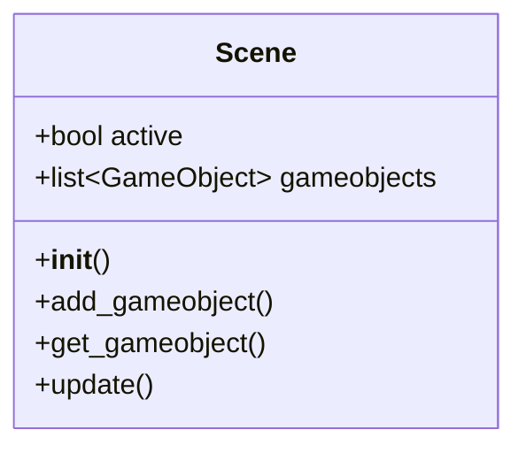
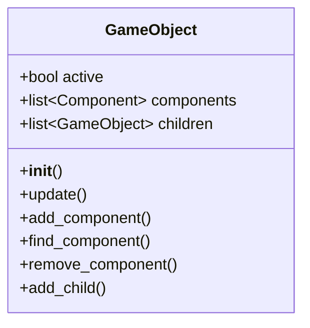
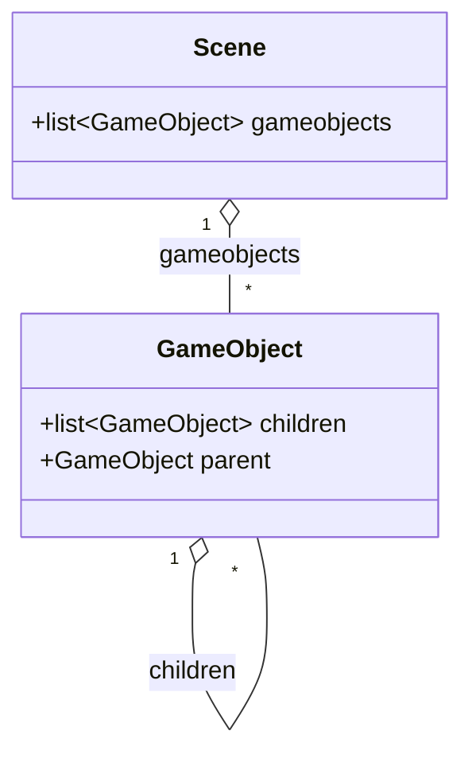
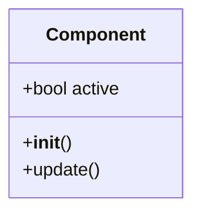
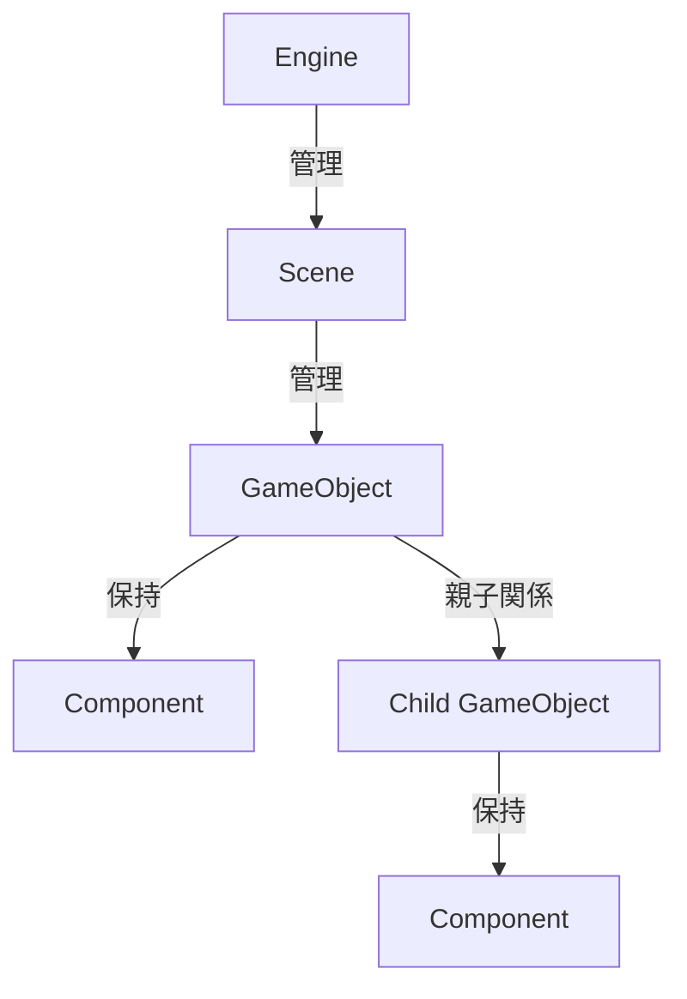
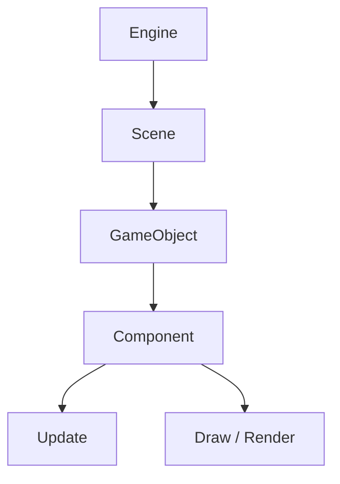

# Py-GameKit

## 1. 概要

Py-GameKit は、Python と Pygame を利用したゲーム開発のためのフレームワークです。

ゲームの実行管理、シーン管理、ゲームオブジェクト管理、コンポーネントによる機能拡張など、ゲーム開発に必要となる基本的な仕組みを提供します。

本ドキュメントでは、Py-GameKit の基本構造、各クラスの役割、クラス間の関係、およびフレームワークの設計について説明します。

---

## 2. 基本アーキテクチャ

Py-GameKit は、主に以下のクラスを中心に構成されています。

| クラス | 役割 |
|:--|:--|
| Engine | ゲーム全体の実行管理 |
| Scene | ゲーム内のシーン管理 |
| GameObject | ゲーム内オブジェクトの管理 |
| Component | GameObject に機能を追加するための仕組み |

基本的な構造は、Engine が Scene を管理し、Scene が GameObject を管理し、GameObject が Component を保持する構成となっています。

この構造によって、ゲーム全体の管理と個々のゲームオブジェクトの機能を分離しています。

### 2.1 クラス構成

- **Engine**：ゲーム全体の実行を管理する
- **Scene**：ゲーム内のシーンを管理する
- **GameObject**：ゲーム内のオブジェクトを構成する
- **Component**：オブジェクトに機能を追加する
- **Child GameObject**：GameObject の親子関係を構築する

---

## 3. クラス間の関係

以下のクラス図は、Py-GameKit を構成する主要なクラスと、それぞれが保持するオブジェクトの関係を示しています。

### 3.1 クラス間の保持関係

| クラス | 保持対象 | 属性 |
|:--|:--|:--|
| Engine | Scene | `scenes` |
| Engine | 現在のSceneへの参照 | `current_scene` |
| Scene | GameObject | `gameobjects` |
| GameObject | Component | `components` |
| GameObject | 子GameObject | `children` |

各クラスは、それぞれの責務に応じたオブジェクトを保持することで、管理対象を明確に分離しています。

---

## 4. Engine クラス

Engine クラスは、ゲーム全体の実行を管理するクラスです。

複数の Scene を `scenes` で保持し、現在実行対象となる Scene を `current_scene` で参照します。

ゲームの実行状態は `running` によって管理されます。

### 主な役割

- Scene の管理
- 現在の Scene の管理
- ゲームループの実行
- ゲーム全体の更新処理
- ゲーム全体の描画処理

### クラス構成

Engine は、ゲーム全体の処理を統括する上位クラスであり、個々のゲームオブジェクトの詳細な処理を直接管理するのではなく、Scene を通してゲームの実行を制御します。

---

## 5. Scene クラス

Scene クラスは、ゲーム内のシーンを管理するクラスです。

`gameobjects` に GameObject を保持し、シーンに属するオブジェクトの管理を行います。

Scene を分けることで、タイトル画面、ゲーム本編、メニュー画面など、異なるゲーム状態や画面を構成できます。

### 主な役割

- GameObject の管理
- シーンの状態管理
- シーン内オブジェクトの更新
- シーン内オブジェクトの描画

### クラス構成

Scene は GameObject の管理単位として機能し、Engine から実行対象として管理されます。

---

## 6. GameObject クラス

GameObject クラスは、ゲーム内のオブジェクトを構成する基盤クラスです。

プレイヤー、敵、地形、アイテム、エフェクトなど、ゲーム内に存在するさまざまなオブジェクトを GameObject として構成できます。

GameObject 自体は基本的な管理機能を持ち、具体的な機能は Component を追加することで拡張します。

### 主な役割

- オブジェクトの状態管理
- Component の保持・管理
- 子 GameObject の管理
- オブジェクトの更新・描画処理
- Component の追加、検索、削除

### クラス構成

### 6.1 Component による機能拡張

GameObject は `components` に複数の Component を保持できます。

Component を組み合わせることで、GameObject ごとに異なる機能を持たせることができます。

例えば、描画機能や当たり判定などを個別の Component として構成することで、必要な機能だけを GameObject に追加できます。

この仕組みにより、オブジェクトの種類ごとに処理をすべて実装する必要がなくなり、機能の再利用性を高めることができます。

### 6.2 子オブジェクトの管理

GameObject は `children` に子 GameObject を保持することで、オブジェクト同士の親子関係を構築できます。

子 GameObject は親の `children` に登録されると同時に、Scene の `gameobjects` にも登録されます。

そのため、親子関係を構築しながらも、Scene 全体から各 GameObject を管理できます。

親子関係を利用することで、オブジェクトを階層的に構成し、複数の GameObject をまとめて管理することが可能になります。

---

## 7. Component クラス

Component クラスは、GameObject に機能を追加するための基盤クラスです。

GameObject に Component を追加することで、オブジェクトごとに必要な機能を構成できます。

Component は GameObject に所属し、GameObject を通して管理されます。

### 主な役割

- GameObject への機能追加
- Component の状態管理
- Component の開始処理
- Component の更新処理
- Component の描画処理

### クラス構成

### 7.1 Component の状態

Component は、以下の属性によって状態を管理します。

| 属性 | 型 | 説明 |
|:--|:--|:--|
| `active` | bool | Component の有効状態 |
| `is_started` | bool | 開始処理の実行状態 |

これらの状態を利用することで、Component ごとに実行状態を管理できます。

### 7.2 Component の拡張

Component を継承して独自の機能を実装することで、GameObject に新しい機能を追加できます。

Component を個別に実装することで、機能単位でコードを分離し、異なる GameObject 間で再利用できます。

---

## 8. オブジェクト管理の仕組み

Py-GameKit では、Engine、Scene、GameObject、Component の各クラスが、それぞれ異なる管理対象を持っています。

| 管理階層 | 管理対象 | 管理方法 |
|:--|:--|:--|
| Engine | Scene | `scenes` |
| Engine | 現在のScene | `current_scene` |
| Scene | GameObject | `gameobjects` |
| GameObject | Component | `components` |
| GameObject | 子GameObject | `children` |

この階層構造によって、ゲーム全体から個々の機能まで、それぞれの管理範囲を明確にしています。

---

## 9. 基本的な処理構造

Py-GameKit は Engine を起点としてゲームを実行し、Scene、GameObject、Component を通してゲームの処理を構成します。

基本的な処理の流れは以下のとおりです。

各クラスは、それぞれの管理対象に対して開始・更新・描画などの処理を提供します。

- Engine：ゲーム全体の実行を管理
- Scene：シーン単位の処理を管理
- GameObject：オブジェクト単位の処理を管理
- Component：機能単位の処理を実装

具体的な実行順序や各処理の呼び出し条件については、実装に基づく詳細仕様を参照してください。

---

## 10. 設計方針

Py-GameKit は、ゲーム全体の管理と個々のオブジェクトの機能を分離し、拡張しやすい構造を目指しています。

### 10.1 責務の分離

Engine、Scene、GameObject、Component それぞれに管理対象を持たせ、役割を分離しています。

これにより、ゲーム全体の実行管理、シーンの管理、オブジェクトの管理、機能の実装を、それぞれ独立した単位として扱えます。

### 10.2 Component による機能構成

GameObject に機能を直接集中させるのではなく、Component に機能を分離することで、オブジェクトごとに必要な機能を組み合わせられる構造としています。

### 10.3 GameObject の階層化

GameObject に親子関係を持たせることで、ゲーム内のオブジェクトを階層的に構成できます。

これにより、単一の GameObject だけでは表現しづらい複合オブジェクトも構築できます。

### 10.4 再利用性と拡張性

Component を個別の機能単位として実装することで、複数の GameObject で同じ機能を利用できます。

また、既存の基盤クラスを利用しながら、新しい GameObject や Component を追加することで、フレームワークの基本構造を維持したまま拡張できます。

---

## 11. まとめ

Py-GameKit は、Engine、Scene、GameObject、Component を中心とした構造によってゲームの実行とオブジェクト管理を行います。

Engine がゲーム全体を管理し、Scene が GameObject を管理し、GameObject が Component を保持することで、ゲームを複数の管理単位に分離しています。

また、Component による機能拡張と GameObject の親子関係によって、柔軟なオブジェクト構成を可能にしています。

この基本構造を理解することで、Py-GameKit の機能を利用したゲーム開発だけでなく、フレームワーク自体の拡張や改善にも取り組むことができます。

